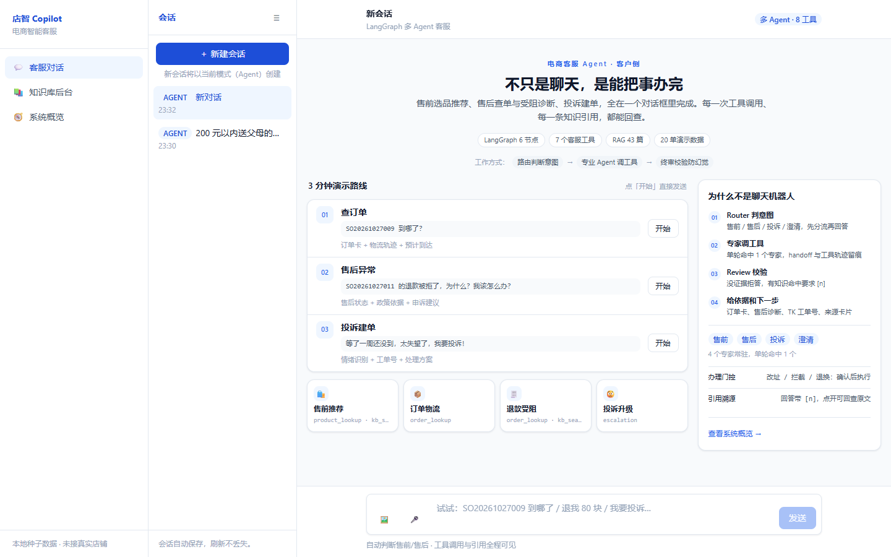
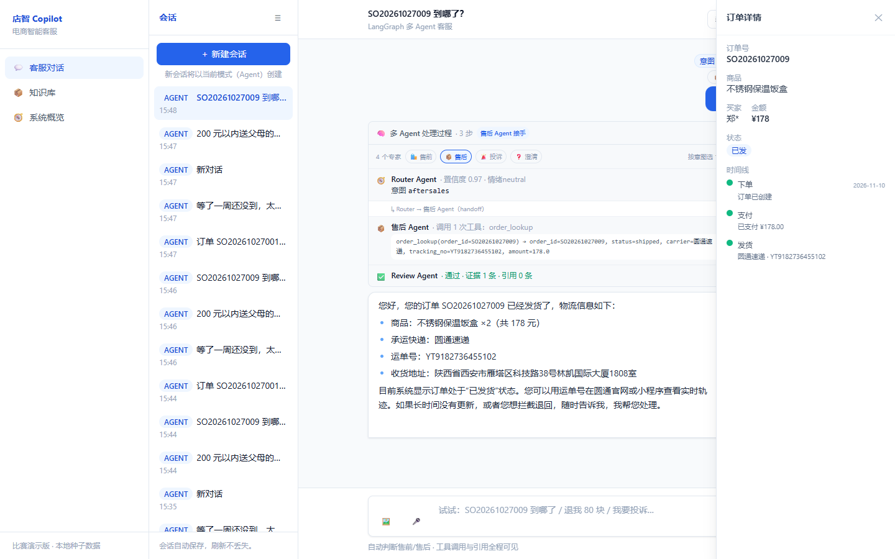
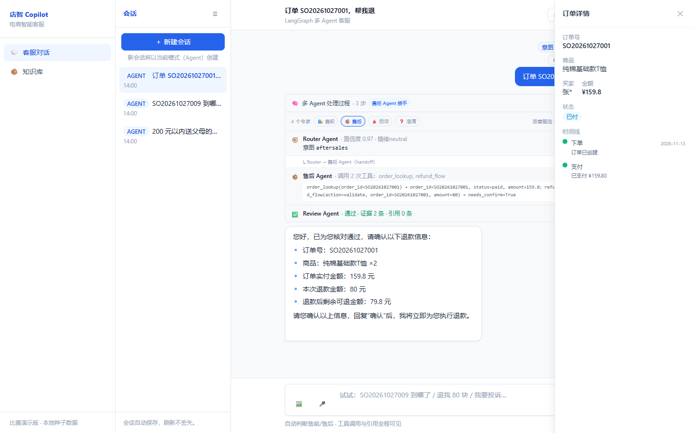
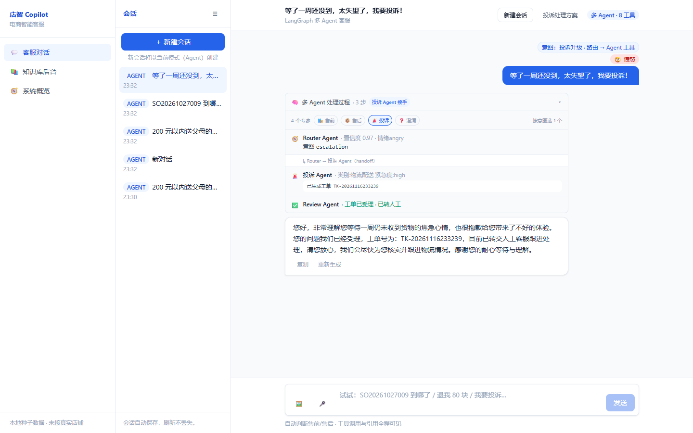
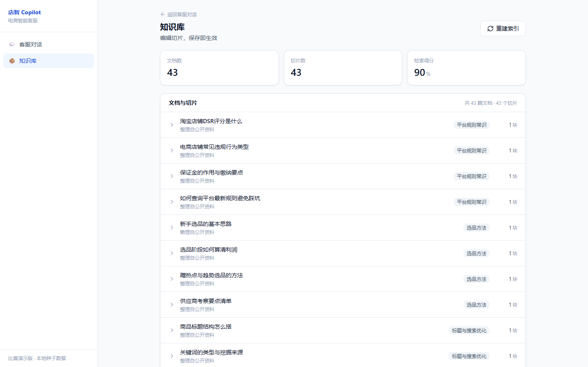

# 店智 Copilot——面向客户的电商智能客服 Agent

**团队信息**：邢博、刘庆昊、孔克铮 / 河北传媒学院 / 人工智能

> 售前查商品推荐、售后查订单退款、投诉生成工单，一个对话框全搞定。不是只会聊天的问答工具，而是能调用工具、能校验、能溯源、敏感操作需客户确认的智能客服。

## 一、项目详情及使用方式

店智 Copilot 面向电商店铺的**客户**（下单前咨询、下单后查单退款投诉），解决"问商品、查订单、办售后"反复在多个页面之间切换的问题。系统把服务收进两个业务入口，并提供独立的系统概览页 `/overview`：

- **客服对话 `/chat`**：LangGraph 多 Agent 编排，Router 自动判断售前/售后/投诉/澄清，调用对应工具，回答带 `[n]` 引用可溯源。
- **知识库 `/kb`**：43 篇运营知识文档，商家维护商品知识/售后政策，Agent 据此回答；支持切片编辑，保存后重新嵌入并失效旧检索。

项目自带 20 单模拟订单、12 个 SKU 和 43 篇知识库语料，不依赖真实平台授权。启动方式：

```bash
pip install -r backend/requirements.txt
cp backend/.env.example backend/.env
# 填入 DEEPSEEK_API_KEY
python -m backend.app.rag.pipeline build
uvicorn backend.app.main:app --port 8000
```

另一个终端：

```bash
npm install
npm run dev
```

打开 `http://localhost:3000`（`/` 自动跳 `/chat`），按"客服对话 → 售前咨询 → 查订单 → 退款门控 → 投诉升级 → 知识库编辑"的顺序即可完成演示。



![图 2：售前咨询，Agent 推荐商品并带 [1] 引用](submission-assets/02-presales.png)

## 二、项目亮点

1. **不是只会聊天的问答工具，而是能办事的客服**  
   查订单、查物流、退款、改地址、拦截物流、退换货都在同一个对话里完成，用户不用在"问"和"做"之间切换系统。

2. **LangGraph 多 Agent 路由，不是所有问题都走向量检索**  
   Router 先判断售前咨询 / 售后处理 / 投诉升级 / 追问澄清，再交给对应专业 Agent；同时输出置信度与情绪标签，愤怒或焦虑的客户先安抚再办事。售前只拿商品与知识工具，售后只拿订单与办理工具，职责在工具集层面隔离。

3. **RAG 回答带 `[1][2]` 角标，来源可点开核对**  
   回答不是"模型凭印象说"，而是先检索知识库，再把命中的文档片段拼进上下文。点角标能看到标题、分类和原文片段。

4. **Agent 过程透明**  
   LangGraph 编排，每个 specialist 内部最多 5 步工具调用；「多 Agent 处理过程」面板把专家接手、handoff、工具名与关键返回字段、终审裁决逐步摊开。主链路 7 个客服工具（`kb_search` 售前售后共用，按工具位算 8 个），另有 3 个运营向工具经 MCP 暴露（MCP 共 4 个）。

5. **敏感操作两段式门控**  
   退款、改地址、物流拦截、退换货统一走 `validate → 用户确认 → execute`。模型不能直接动钱；校验不通过时直接列出原因，例如"退款金额 418 超过实付 159.8"。

6. **知识库编辑即生效**  
   修改切片后重新嵌入，旧检索立即失效，下一次提问就能看到新口径，不需要重启服务。

7. **真实数据可插拔**  
   `DataProvider` 协议把数据源和 Agent 解耦，默认 SQLite 种子库，也可以接 MySQL、ERP API 或 CSV。

8. **会话可恢复、安全边界清楚**  
   LangGraph `SqliteSaver` 按 `thread_id` 持久化检查点，刷新或重启后继续会话；前端永远不直连模型 API，DeepSeek Key 只放在 Python 层 `backend/.env`。





## 三、AI 测试技术落地使用情况概述

项目把 AI 能力拆成可复现的测试对象，不只靠人工点页面：

| 测试层 | 内容 | 结果 |
|---|---|---|
| 静态检查 | `tsc`、`eslint`、`next build` | 全部通过 |
| 接口冒烟 | 7 个接口 + 2 个页面，双服务联调 | **9/9 通过** |
| 功能回归 | 意图 4 路、引用 `[1]`、SqliteSaver 落盘、追问不误伤 | 通过 |
| RAG 检索自测 | 10 个查询，top-3 命中 | **9/10 = 90%** |
| RAG 效果评测 v1 | 20 题、40 分制、有/无 RAG 对照 | **26 vs 23** |
| RAG 效果评测 v2 | 15 题、30 分制、有/无 RAG 对照 | **29 vs 30** |

v2 的结果没有刻意美化：通用常识题上，不带 RAG 的模型本身也能答对，所以无 RAG 反而 30/30；有 RAG 29/30。这说明 RAG 的增量主要在**平台私有规则、知识库口径、引用可溯源**，而不是所有题都靠检索。测试还暴露并修复了一个真实问题：早期 RAG 注入只截取 chunk 前 300 字，FABE 示例恰好落在 300 字之后，导致回答缺证据；改为完整原文后恢复得分。

另外还覆盖了：

- 意图路由：4 类意图 + 5 类情绪标签；LLM 失败或非法输出时降级为 `clarify`，先追问再分流，不阻断对话。
- Agent 工具调用：`product_lookup`、`order_lookup`、`kb_search`、`refund_flow validate/execute` 等。
- 退款门控：校验失败、重复提交、幂等执行。
- 终审防幻觉：无工具证据拒答、有命中但缺 `[n]` 告警、追问式回复不误伤。
- 缺 Key / 缺知识库 / 上游 503 的降级路径。
- 会话持久化（SqliteSaver 跨实例读取）、引用角标与 `/v1/rag/search` 同源核对。

测试脚本可复现：

```bash
node scripts/smoke.mjs
python -m backend.app.rag.selftest
python -m backend.app.rag.eval
python -m backend.app.rag.eval_v2
```



## 四、项目中涉及的关键技术

- **前端**：Next.js 16 App Router、TypeScript strict、Tailwind CSS、SSE 流式渲染（自研 `agentRun` 解析 step / delta / done 事件）。
- **后端**：Python 3.12、FastAPI、httpx、SQLite、Pydantic。
- **RAG**：jieba BM25 + fastembed BGE-small-zh 向量 + LanceDB + RRF 融合；top-4 检索；引用角标与 `/v1/rag/search` 同源。
- **Agent**：LangGraph 0.2.8 StateGraph（Router→售前/售后/投诉→终审）+ DeepSeek function calling；specialist 内最多 5 步；7 个客服工具（按工具位 8 个）+ 3 个运营向工具（MCP 暴露 4 个）；SSE 事件 `delta/done/error`，工具轨迹随 `done` 下发。
- **记忆**：`langgraph-checkpoint-sqlite` 的 SqliteSaver，`thread_id` 与前端会话 ID 全链路一致。
- **MCP**：FastMCP stdio 独立进程，复用 Agent 工具注册表。
- **安全**：前端不直连模型；Key 只在 Python 层；同源 `/api/*` 代理；`.env` 不入库。
- **测试**：`smoke.mjs`、RAG selftest、v1/v2 评测集、意图与门控回归脚本。



## 五、项目相关的图片/照片

本文档使用 6 张真实运行截图：

1. 客服对话首页：3 分钟演示路线、能力卡与输入区（图 1）。
2. 售前咨询：Agent 推荐商品，回答带 `[1]` 引用（图 2）。
3. 查订单：订单卡与「order_lookup」工具轨迹（图 3）。
4. 退款门控：校验预览、金额与剩余额度（图 4）。
5. 投诉升级：工单号、类别、紧急度（图 5）。
6. 知识库：切片编辑与即时生效（图 6）。

截图均来自本地演示数据，不含真实客户信息、API Key 或 `.env` 内容。

## 六、项目之前是否发表过或获奖

截至本次提交，本项目未公开发表、未参加其他比赛、未获奖。  
如团队有其他相关获奖或发表，请在此处补充；没有则保留本段。

## 七、若项目是在其他项目基础上优化，请说明优化部分

本项目为原创开发，**不是基于其他参赛项目或代码库二次开发**。项目使用 Next.js、FastAPI 等开源框架和官方脚手架初始化；方案调研阶段参考了公开电商 RAG / Agent 项目的架构思路，但业务代码、演示数据、页面设计、工具实现和评测脚本均为自研。

如实际参考了某个具体开源仓库的代码，请补充仓库名、许可证和复用范围；没有代码复用则保留本段。
