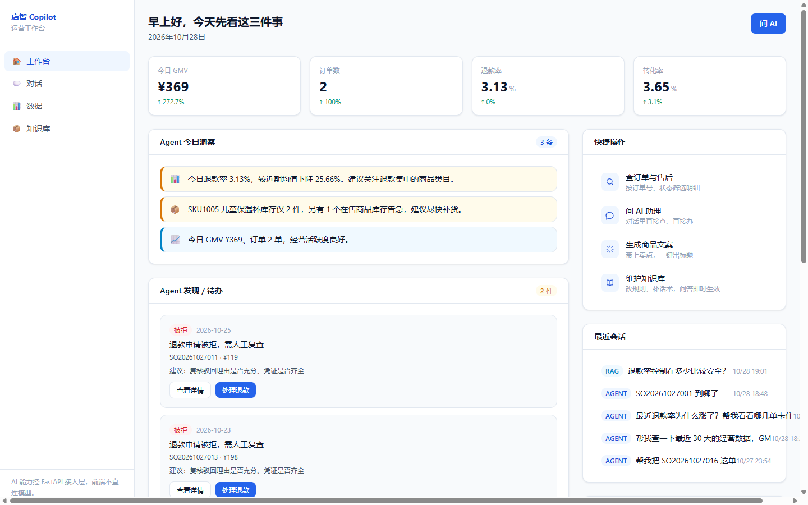
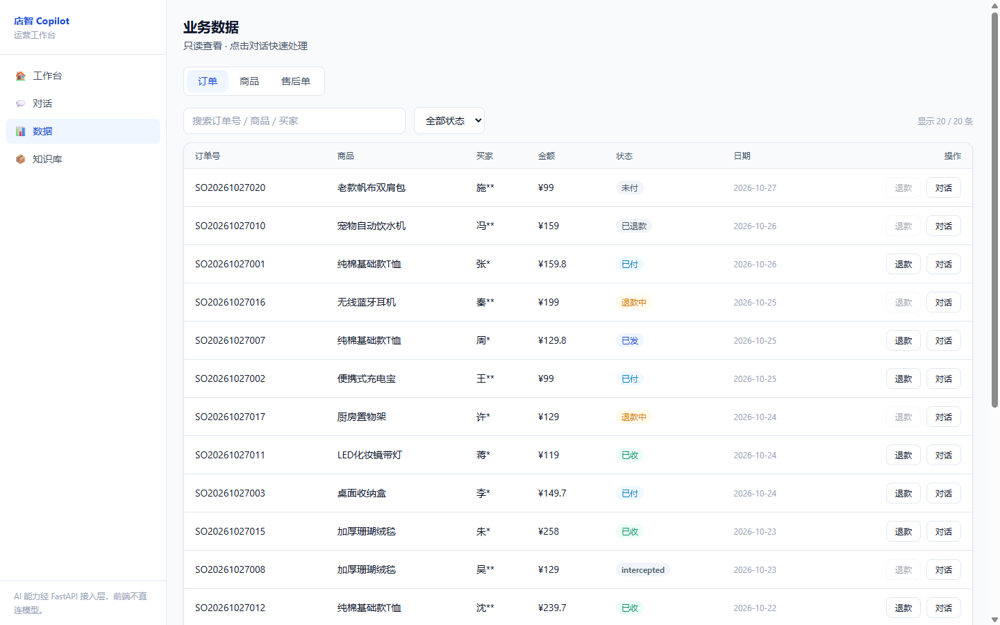
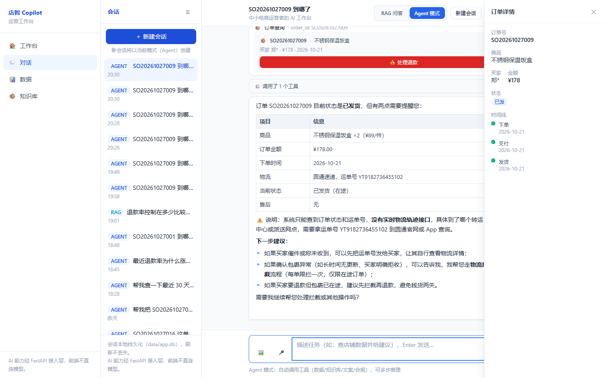
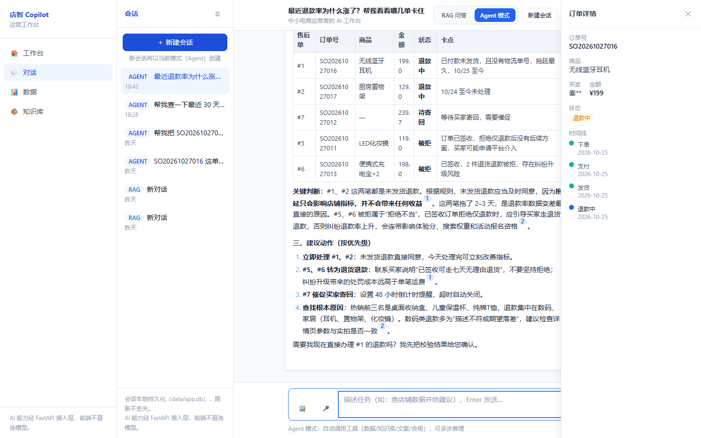
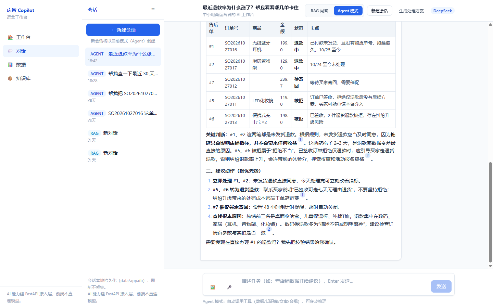
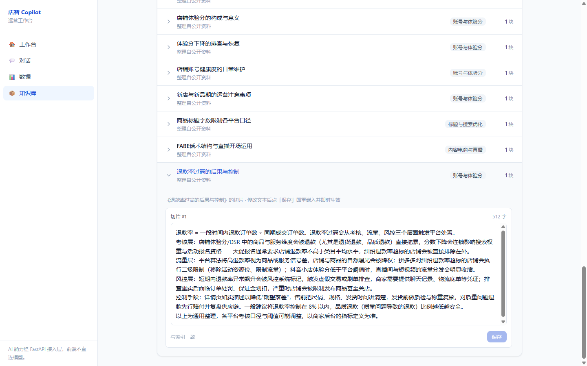

# 店智 Copilot——中小电商运营者的 AI 工作台

**团队信息**：邢博、刘庆昊、孔克铮 / 河北传媒学院 / 人工智能

> 把看数据、查订单、处理售后、查平台规则、写商品文案收进一个对话框。不是只会聊天的问答工具，而是能调用工具、能校验、能溯源的工作台。

## 一、项目详情及使用方式

店智 Copilot 面向中小电商运营者，解决日常运营中“后台多、表格散、规则更新快、售后操作风险高”的问题。系统把高频工作收进四个入口：

- **工作台**：GMV、订单数、退款率、转化率、待办、最近会话、趋势和热销商品。
- **对话**：RAG 问答与 Agent 双模式，支持意图自动路由、工具步骤卡、引用溯源。
- **数据**：订单、商品、售后三张只读表，支持搜索、状态筛选、行内发起对话和退款。
- **知识库**：43 篇运营知识文档，支持切片编辑；保存后重新嵌入并失效旧检索。

项目自带 20 单模拟订单和 43 篇知识库语料，不依赖真实平台授权。启动方式：

```bash
pip install -r backend/requirements.txt
cp backend/.env.example backend/.env
# 填入 DEEPSEEK_API_KEY
python -m backend.app.rag.pipeline build
uvicorn backend.app.main:app --port 8000
```

另一个终端：

```bash
npm install
npm run dev
```

打开 `http://localhost:3000`，按“工作台 → 数据 → 对话查订单 → 退款校验 → RAG 问答 → Agent 工具调用”的顺序即可完成演示。





## 二、项目亮点

1. **不是只会聊天的问答工具，而是能办事的工作台**  
   查单、看数、退款校验、规则问答、文案生成都在同一个对话里完成。

2. **意图路由，不是所有问题都走向量检索**  
   `knowledge / general` 走 RAG；`data / policy / copywriting` 走 Agent。界面用 chip 显示“数据查询 → Agent”等判断结果，用户知道系统为什么切模式。

3. **RAG 回答带 `[1][2]` 角标，来源可点开核对**  
   回答不是“模型凭印象说”，而是先检索知识库，再把命中的文档片段拼进上下文。点角标能看到标题、分类和原文片段。

4. **Agent 过程透明**  
   手写 ReAct 循环，最多 5 步；每次工具调用都以步骤卡展示“调了什么工具、花了多久、返回什么”。目前注册 10 个工具，覆盖知识检索、数据查询、文案、合规、订单、退款、改地址、物流拦截、退换货。

5. **敏感操作两段式门控**  
   退款、改地址、物流拦截等操作统一走 `validate → 用户确认 → execute`。模型不能直接动钱；校验不通过时直接列出原因，例如“订单已超过 7 天售后期，无法自助退款”。

6. **知识库编辑即生效**  
   修改切片后重新嵌入，旧检索立即失效，下一次提问就能看到新口径，不需要重启服务。

7. **真实数据可插拔**  
   `DataProvider` 协议把数据源和 Agent 解耦，默认 SQLite 种子库，也可以接 MySQL、ERP API 或 CSV。

8. **安全边界清楚**  
   前端永远不直连模型 API；DeepSeek Key 只放在 Python 层 `backend/.env`，所有 AI 请求走 FastAPI。





## 三、AI 测试技术落地使用情况概述

项目把 AI 能力拆成可复现的测试对象，不只靠人工点页面：

| 测试层 | 内容 | 结果 |
|---|---|---|
| 静态检查 | `tsc`、`eslint`、`next build` | 全部通过 |
| 接口冒烟 | 7 个接口 + 4 个页面，双服务联调 | **11/11 通过** |
| API 契约 | 会话、退款、知识库、意图等接口 | **12/12 通过** |
| RAG 检索自测 | 10 个查询，top-3 命中 | **9/10 = 90%** |
| RAG 效果评测 v1 | 20 题、40 分制、有/无 RAG 对照 | **26 vs 23** |
| RAG 效果评测 v2 | 15 题、30 分制、有/无 RAG 对照 | **29 vs 30** |

v2 的结果没有刻意美化：通用常识题上，不带 RAG 的模型本身也能答对，所以无 RAG 反而 30/30；有 RAG 29/30。这说明 RAG 的增量主要在**平台私有规则、知识库口径、引用可溯源**，而不是所有题都靠检索。测试还暴露并修复了一个真实问题：早期 RAG 注入只截取 chunk 前 300 字，FABE 示例恰好落在 300 字之后，导致回答缺证据；改为完整原文后恢复得分。

另外还覆盖了：

- 意图分类：5 类意图 + 关键词兜底；LLM 超时/失败时降级为 `general`，不阻断对话。
- Agent 工具调用：`order_lookup`、`data_query`、`refund_flow validate/execute` 等。
- 退款门控：校验失败、重复提交、幂等执行。
- 缺 Key / 缺知识库 / 上游 503 的降级路径。
- 会话持久化、引用角标与 `/v1/rag/search` 同源核对。

测试脚本可复现：

```bash
node scripts/smoke.mjs
python -m backend.app.rag.selftest
python -m backend.app.rag.eval
python -m backend.app.rag.eval_v2
```



## 四、项目中涉及的关键技术

- **前端**：Next.js 16 App Router、TypeScript strict、Tailwind CSS、Vercel AI SDK、SSE 流式渲染。
- **后端**：Python 3.12、FastAPI、httpx、SQLite、Pydantic。
- **RAG**：jieba BM25 + fastembed BGE-small-zh 向量 + LanceDB + RRF 融合；top-4 检索；引用角标与 `/v1/rag/search` 同源。
- **Agent**：DeepSeek function calling + 手写 ReAct 循环，最多 5 步；10 个工具；SSE 事件 `step/delta/done/error`。
- **MCP**：FastMCP stdio 独立进程，复用 Agent 工具。
- **安全**：前端不直连模型；Key 只在 Python 层；同源 `/api/*` 代理；`.env` 不入库。
- **测试**：`smoke.mjs`、Pytest 风格接口脚本、RAG selftest、v1/v2 评测集、意图分类用例。



## 五、项目相关的图片/照片

本文档使用 6 张真实运行截图：

1. 工作台：4 张 KPI 卡与待办（图 1）。
2. 数据页：订单表与状态筛选（图 2）。
3. 对话：查订单与 Agent 步骤卡（图 3）。
4. 退款：009 订单“超过 7 天售后期”红字拦截（图 4）。
5. RAG：回答与 `[1]` 来源卡（图 5）。
6. 知识库：切片编辑与即时生效（图 6）。

截图均来自本地演示数据，不含真实客户信息、API Key 或 `.env` 内容。

## 六、项目之前是否发表过或获奖

截至本次提交，本项目未公开发表、未参加其他比赛、未获奖。  
如团队有其他相关获奖或发表，请在此处补充；没有则保留本段。

## 七、若项目是在其他项目基础上优化，请说明优化部分

本项目为原创开发，**不是基于其他参赛项目或代码库二次开发**。项目使用 Next.js、FastAPI 等开源框架和官方脚手架初始化；方案调研阶段参考了公开电商 RAG / Agent 项目的架构思路，但业务代码、演示数据、页面设计、工具实现和评测脚本均为自研。

如实际参考了某个具体开源仓库的代码，请补充仓库名、许可证和复用范围；没有代码复用则保留本段。
